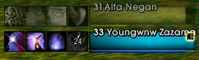
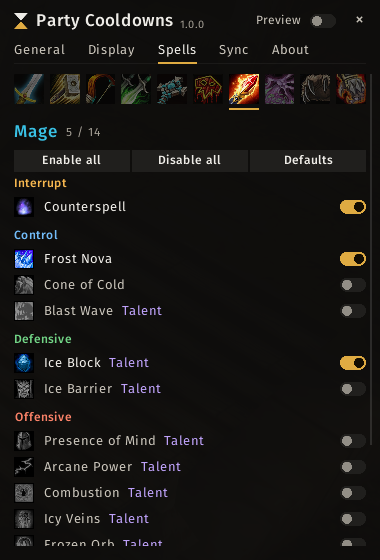
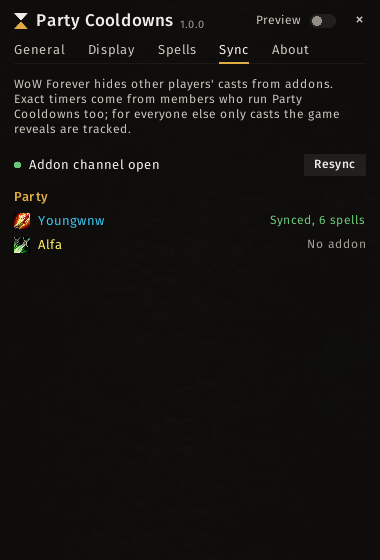
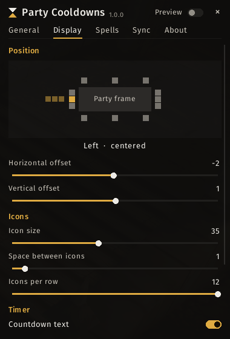

# Party Cooldowns

> **Everyone in your party needs to have this addon installed.** WoW Forever hides other players' casts from addons, so cooldowns of players without it can't be tracked properly.

Shows your party's important cooldowns next to the party frames in WoW Forever: if the rogue has Kick, if the mage can Polymorph again, if the warrior already used Shield Wall.

## What it tracks

Interrupts, crowd control, defensives and a few other big cooldowns for all nine classes, plus racials of every race, Skyborne included. Priest spells that only one race gets, like Feedback for humans, show up only for priests of that race. You can turn each spell on or off in the settings. Talent spells only show up for players who actually have the talent. If a spell you need is missing, you can add it yourself.

## Custom spells

Open the Spells tab, pick the class and type the spell ID into the field under **Custom spells**, then press **Add** or Enter. Any rank of the spell works. The name works too, but only for spells in your own spellbook. You can add up to 20 spells, and the × next to a spell removes it.

A custom spell shows up for party members who have an up-to-date Party Cooldowns and know the spell. Their addon learns the list from yours, so they don't have to add the spell themselves. The timer comes from their game after the first cast. Players without the addon never show custom spells, because Forever hides their casts.

## Asking for a cooldown

Click a ready icon and the addon asks that player to use the spell: "Tanky, please use Shield Wall". It goes to party chat by default. On the General tab you can switch it to a whisper or turn it off. Clicking the same icon again within 5 seconds does nothing, so a double click doesn't spam the chat.

Forever can stop addons from writing to chat during some fights. When that happens nothing is sent and you see an error at the top of the screen.

## Party frames

The icons attach to whatever party frames you use:

- Blizzard party frames
- Raid-style party frames
- EllesmereUI
- ElvUI

The addon finds them on its own.

## Why the whole party needs it

Forever doesn't let addons see what spells other players cast. So the addon can only show exact timers for people who have it installed too. Those players send their cooldowns to each other through the addon channel.

Players without the addon still show up. Their icons stay dim and only update when the game lets the addon see a cast, like the top row in the first screenshot.

The Party tab in the settings shows who in your group has the addon.

## Settings

Type `/pcd`, click the minimap button or right-click any cooldown icon. In the settings you can change:

- which side of the frame the icons go on, and the offset
- icon look: flat with a thin black border (default), or Blizzard with the same frame as your action buttons
- icon size (28 by default), spacing (3) and how many fit in a row (6)
- countdown text, the clock sweep, grey icons while on cooldown and a flash when a spell is ready

The window has a preview, so you can set everything up while solo.

